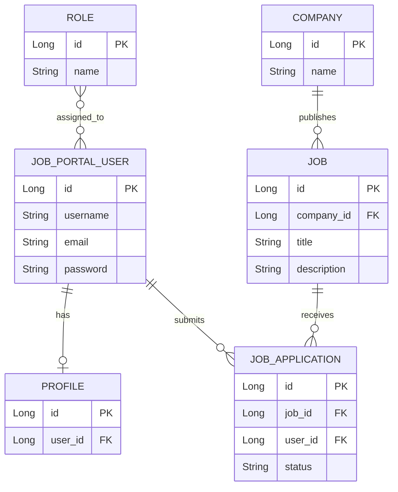

# 🚀 Job Portal Backend

A role-based job portal backend built using Java 21 and Spring Boot 4. The platform connects job seekers with employers, allowing companies to publish job opportunities and candidates to discover, save, and apply for jobs.

Designed with a layered architecture, JWT authentication, PostgreSQL, Redis caching, and modern Spring Boot technologies.

\<p align="center">   \<a href="[https://jobportalfrontendrepo.onrender.com/](https://jobportalfrontendrepo.onrender.com/)">     \   \</a> \</p>

\<p align="center">   \   \   \   \   \   \ \</p>

---

## 🔥 Current Project Highlight

### Real-Time Job Ingestion from Company Career Websites

\<sub>Currently exploring and designing this functionality.\</sub>

One of the major upcoming enhancements is to make the job portal capable of automatically discovering and publishing job opportunities directly from company career websites.

Currently, job listings are populated through seeded or manually managed data. I am exploring a modular architecture that will allow different companies to integrate their own job sources.

The proposed functionality includes:

- Automated job discovery from company career pages.
- Integration with official company APIs and supported job feeds.
- Company-specific job source adapters.
- Automatic synchronization of newly published opportunities.
- Duplicate job detection and job expiration management.
- Keeping job listings updated without manual intervention.

The objective is to build a centralized job discovery platform where new opportunities can become available as companies publish them.

**Development status:** Research and architectural exploration. This functionality has not been implemented yet.

---

## ✨ Features

### Job Seeker

- Browse and search available jobs.
- Apply for job opportunities.
- Save jobs for later.
- Track application status.
- Manage personal profiles.

### Employer & Admin

- Manage companies.
- Create, update, and manage job postings.
- Review candidate applications.
- Manage platform resources.

### Authentication & Security

- JWT-based stateless authentication.
- Custom JWT validation filter.
- Role-based access control.
- Separate authentication providers for production and non-production environments.
- Configurable CORS policies.

### Performance & Monitoring

- Redis caching for jobs, companies, and roles.
- Configurable cache TTL and maximum size.
- AOP-based logging and performance monitoring.
- Login and exception auditing.
- Spring Boot Actuator health and metrics.
- OpenTelemetry integration hooks.

### Application Engineering

- Centralized exception handling.
- Bean validation.
- JPA auditing using BaseEntity.
- OpenAPI and Swagger UI documentation.
- External API integration using Spring HTTP interfaces and RestClient.

---

## 🛠️ Technology Stack

| Category          | Technology                          |
| ----------------- | ----------------------------------- |
| Language          | Java 21                             |
| Backend Framework | Spring Boot 4.0.5                   |
| Web               | Spring MVC                          |
| Security          | Spring Security, JWT                |
| ORM               | Spring Data JPA, Hibernate          |
| Database          | PostgreSQL                          |
| Caching           | Redis                               |
| API Documentation | Springdoc OpenAPI 3.0.2             |
| Build Tool        | Maven                               |
| Containerization  | Docker, Docker Compose              |
| Monitoring        | Spring Boot Actuator, OpenTelemetry |
| Utilities         | Lombok                              |
| Deployment        | Render                              |
| Database Hosting  | Aiven PostgreSQL                    |

---

## 🏗️ System Architecture

The backend follows a layered architecture with a clear separation of responsibilities.

### High-Level Architecture


*The architecture diagram illustrates frontend communication, JWT security, controllers, services, repositories, PostgreSQL, Redis caching, and the planned job ingestion component.*

### Request Processing Flow

```text
React Frontend
      |
      | REST APIs + JWT
      v
Security Layer
      |
      v
Controllers
      |
      v
Services
      |
      +-------> Redis Cache
      |
      v
Repositories (JPA)
      |
      v
PostgreSQL
```

---

## 🗄️ Database Design

The application uses PostgreSQL as its primary relational database.

### Core Domain Entities

| Entity         | Responsibility                   |
| -------------- | -------------------------------- |
| JobPortalUser  | User accounts and authentication |
| Role           | Role-based authorization         |
| Company        | Company information              |
| Job            | Job postings                     |
| JobApplication | Candidate applications           |
| Profile        | Job seeker profile information   |
| Contact        | Contact form submissions         |
| BaseEntity     | Common auditing information      |

### Entity Relationship Diagram

The following is a conceptual representation of the core domain relationships. Confirm the cardinalities against the actual JPA mappings.



---

## 📂 Project Structure

The application follows a feature-based package structure under `com.sp.jobportal`.

```text
src/main/java/com/sp/jobportal
│
├── Application.java
│
├── aspects/                 # Logging, auditing and performance
├── auditawareref/           # JPA auditing configuration
│
├── auth/
│   └── controller/          # Authentication and registration
│
├── client/                  # External API integrations
├── company/                 # Company management
├── contact/                 # Contact functionality
├── job/                     # Job management and applications
├── user/                    # User and profile management
│
├── config/
│   ├── cache/               # Redis configuration
│   └── web/                 # Web configuration
│
├── security/
│   ├── config/              # Security configuration
│   ├── controller/          # Security endpoints
│   ├── filter/              # JWT validation filter
│   └── util/                # JWT and security utilities
│
├── dto/                     # Request and response DTOs
├── entity/                  # JPA entities
├── repository/              # Spring Data repositories
├── exception/               # Global exception handling
└── constant/                # Application constants
```

---

## ⚡ Redis Caching

Redis is used to improve response times and reduce unnecessary database queries.

| Cache     |        TTL | Maximum Entries |
| --------- | ---------: | --------------: |
| jobs      | 12 minutes |           5,000 |
| companies | 13 minutes |             500 |
| roles     |      1 day |             100 |

A custom TypedJsonRedisSerializer handles typed JSON serialization and deserialization, including collections.

---

## 🔐 Authentication Flow

The application uses Spring Security with stateless JWT authentication.

1. User submits login credentials.
2. Backend validates the credentials.
3. JWT is generated and returned.
4. Frontend sends the token with subsequent requests.
5. JwtTokenValidatorFilter validates the token.
6. Role-based authorization controls access to protected resources.

Example:

```http
Authorization: Bearer <your-jwt-token>
```

---

## 📖 API Documentation

Interactive API documentation is generated using Springdoc OpenAPI.

| Resource        | URL                                                                                                |
| --------------- | -------------------------------------------------------------------------------------------------- |
| Swagger UI      | [http://localhost:8080/swagger-ui/index.html](http://localhost:8080/swagger-ui/index.html)         |
| OpenAPI JSON    | [http://localhost:8080/v3/api-docs](http://localhost:8080/v3/api-docs)                             |
| Actuator Health | [http://localhost:9090/jobportal/actuator/health](http://localhost:9090/jobportal/actuator/health) |

### API Modules

| Controller        | Responsibility                  |
| ----------------- | ------------------------------- |
| AuthController    | Registration and login          |
| UserController    | User and profile management     |
| JobController     | Job operations and applications |
| CompanyController | Company management              |
| ContactController | Contact form                    |
| CsrfController    | CSRF token endpoint             |
| PostController    | External API integration        |
| TodosController   | External API integration        |

---

## 🚀 Getting Started

### Prerequisites

- Java 21
- Docker and Docker Compose
- PostgreSQL
- Redis
- Git

Maven is optional because the project includes Maven Wrapper.

### 1. Clone Repository

```bash
git clone <your-repository-url>
cd backend-jobportal
```

### 2. Start Dependencies

```bash
docker compose up -d
```

### 3. Configure Environment

Configure the following variables:

| Variable                    | Description               |
| --------------------------- | ------------------------- |
| postgre-aivencloud-username | PostgreSQL username       |
| postgre-aivencloud-password | PostgreSQL password       |
| LOG_LEVEL                   | Application logging level |

Update database URL, Redis configuration, CORS origins, and JWT secrets in the application configuration.

Never commit actual credentials or production secrets.

### 4. Run Application

Windows:

```bash
mvnw.cmd spring-boot:run
```

Linux / macOS:

```bash
./mvnw spring-boot:run
```

Backend URL:

```text
http://localhost:8080
```

### 5. Build Application

```bash
./mvnw clean package
```

Run the generated JAR:

```bash
java -jar target/jobportal-aws-deployment.jar
```

### 6. Execute Tests

```bash
./mvnw test
```

---

## 🐳 Docker

Build the Docker image:

```bash
docker build -t jobportal-backend .
```

Run the container:

```bash
docker run -p 8080:8080 \
  -e postgre-aivencloud-username=<username> \
  -e postgre-aivencloud-password=<password> \
  jobportal-backend
```

---

## ☁️ Deployment

The application is currently deployed using:

| Component | Platform         |
| --------- | ---------------- |
| Frontend  | Render           |
| Backend   | Render (Docker)  |
| Database  | Aiven PostgreSQL |

Live Application:

[https://jobportalfrontendrepo.onrender.com/](https://jobportalfrontendrepo.onrender.com/)

---

## 🔄 CI/CD – GitHub Actions

Planned automated build and test pipeline using GitHub Actions.

The workflow will execute Maven verification whenever code is pushed or a pull request is opened.

Create the following file:

`.github/workflows/maven.yml`

```yaml
name: Java Backend CI

on:
  push:
    branches: [ main ]
  pull_request:
    branches: [ main ]

jobs:
  build:
    runs-on: ubuntu-latest

    steps:
      - name: Checkout Repository
        uses: actions/checkout@v4

      - name: Set up Java 21
        uses: actions/setup-java@v4
        with:
          java-version: '21'
          distribution: 'temurin'
          cache: maven

      - name: Grant Maven Wrapper Permission
        run: chmod +x mvnw

      - name: Build and Run Tests
        run: ./mvnw clean verify
```

---

## 🗺️ Development Roadmap

| Feature                               | Status      |
| ------------------------------------- | ----------- |
| Role-based authentication             | Implemented |
| Job management                        | Implemented |
| Company management                    | Implemented |
| Job applications                      | Implemented |
| Redis caching                         | Implemented |
| PostgreSQL integration                | Implemented |
| Docker deployment                     | Implemented |
| Real-time job ingestion research      | In Progress |
| Modular company-specific job adapters | Planned     |
| Automated job synchronization         | Planned     |
| Duplicate detection and expiration    | Planned     |
| Detailed API route documentation      | Planned     |
| GitHub Actions CI pipeline            | Planned     |

---

## 🤝 Frontend

The frontend is developed using React.

Live URL: https://jobportalfrontendrepo.onrender.com/

---

## 👨‍💻 Author
Suraj Yadav

Backend Developer | Java | Spring Boot | Microservices

Interested in developing scalable backend applications, distributed systems, REST APIs, and cloud-native solutions.

- GitHub: https://github.com/surajya
- LinkedIn: https://www.linkedin.com/in/surajy1/


**Building today. Exploring what's next.**
